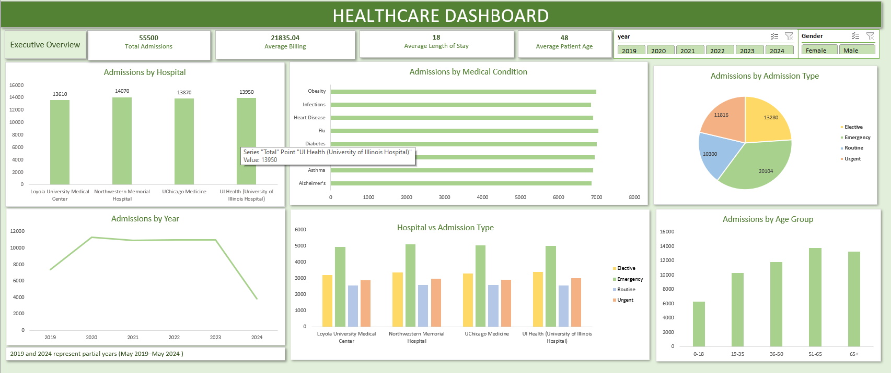
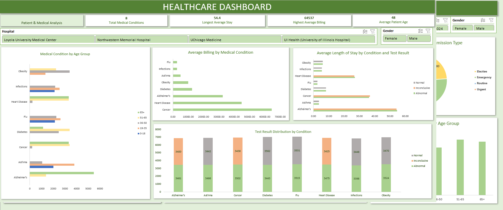
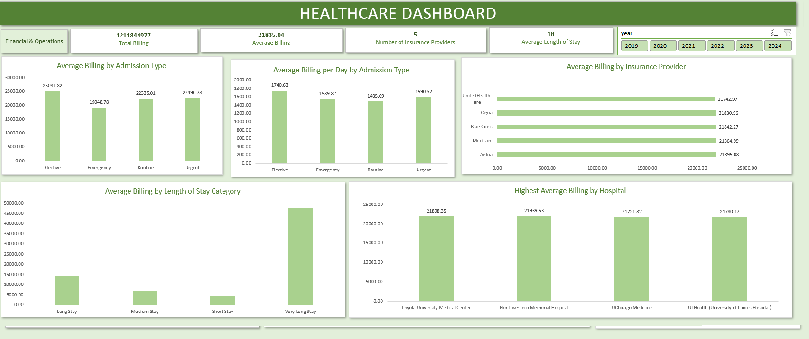

# 🏥 Hospital Management Data Analysis

## 📌 Project Overview
An Excel-based hospital management analysis project designed to explore patient admissions, medical conditions, hospital performance and financial operations.

The project uses interactive dashboards to identify patterns and understand hospital performance through data visualization.

## 🛠️ Tools Used
- Microsoft Excel
- Pivot Tables
- Pivot Charts
- Slicers
- Data Cleaning
- Dashboard Design

## 📊 Key Performance Indicators

| KPI | Value |
|---|---:|
| Total Admissions | 55,500 |
| Average Billing | 21,835.04 |
| Average Length of Stay | 18 days |
| Average Patient Age | 48 years |
| Total Medical Conditions | 8 |
| Number of Insurance Providers | 5 |

## 📈 Dashboard Pages

### 1. Executive Overview
Analyzes total admissions, hospital-wise performance, medical conditions, admission types, yearly trends and patient age groups.

### 2. Patient & Medical Analysis
Explores medical conditions across age groups, average billing by medical condition, length of stay and test result distribution.

### 3. Financial & Hospital Operations
Examines billing patterns across admission types, insurance providers, hospitals and length-of-stay categories.

## 💡 Key Insights
- Emergency admissions recorded the highest volume, with 20,104 admissions.
- The 51–65 age group had the highest number of admissions.
- Cancer showed the highest average billing among the medical conditions displayed.
- Elective admissions had the highest average billing among admission types.
- Average billing varied across hospitals and insurance providers.
- 2019 and 2024 represent partial years in the admission trend analysis.

## 📁 Project Files
- `hospital_management.xlsx` – Excel workbook containing the analysis and dashboards.
- `Hospital_Management_Dashboard_Presentation.pptx` – Project presentation.
- Dashboard screenshots – Visual previews of the three dashboard pages.

## 🎯 Project Objective
To transform hospital management data into meaningful insights that help understand patient demographics, medical trends, hospital performance and financial operations.
